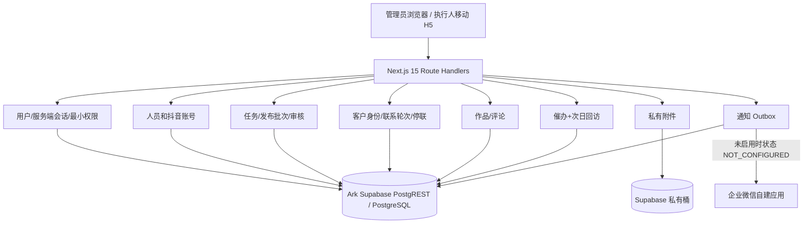
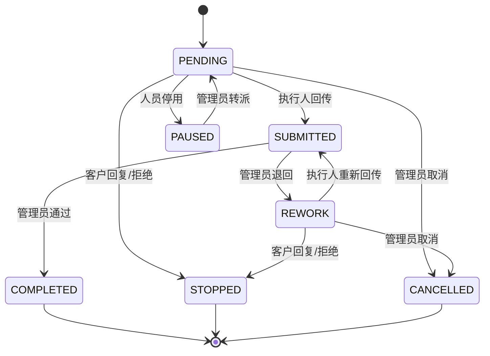

# 正式工程架构、数据关系与状态边界

## 1. 组件分工

架构为**模块化单体**：Next.js 提供认证、后台管理与任务编排，独立定时器调用受保护的调度接口，不引入消息队列、工作流引擎、Redis 或微服务拆分。浏览器调用同源 `/api/proxy`；机器调用使用 Bearer 的 `/api/v1`。Next.js 的 `/api/auth` 和 `/api/proxy` 是 BFF，登录成功后的后台 token 留在受保护 cookie 中。

## 2. 核心业务表

| 类别 | 数据对象 | 唯一性 / 关联 |
|---|---|---|
| 用户与访问 | people, users, sessions, social_accounts | 编号、用户名、会话哈希唯一；账号归属具体人员 |
| 内容 | attachments, content_packages, publish_batches | 图片非公开；内容包须审批方可派单 |
| 客户 | customers, customer_identities, customer_sources, contact_rounds | UID/主页哈希唯一；客户+轮次唯一；一客多来源 |
| 执行 | tasks, works, comments, task_submissions, contact_attempts | 任务编号唯一；作品 URL 哈希唯一；任务提交 revision 唯一；一任务一联系尝试 |
| 可追溯 | notifications, audit_logs | `event_key` 唯一、变更历史审计 |

> 表数可通过 `scripts/check-contract.py` 从部署约定核对；不要依赖这里的手写数量替代实际库统计。

### 2.1 作品任务

内容包创建时状态为草稿；管理员审核通过后才允许创建发布批次。一个批次生成多条独立 `PUBLISH` 任务；每条任务与具体执行人关联，提供素材、发布说明和链接回传表单。执行人提交带合法 HTTPS 域名的抖音作品链接，生成 `works` 记录。PostgreSQL `works.url_hash UNIQUE` 防止同一作品重复建档；管理员审核完成后作品可进入官方评论/真实评论记录流程。

### 2.2 客户主数据

`customer_identities` 仅登记经过人工核验的 UID/主页身份哈希，并使用数据库级复合唯一索引。不根据昵称自动合并客户。多个作品/评论可通过 `customer_sources` 关联同一客户。若多个身份标识指向冲突记录，返回冲突交由管理员复核。

### 2.3 作者/助理首次联系

同一客户首轮 `contact_rounds.round_no=1` 唯一。作者任务和官方助理任务独立创建、独立提交截图；依照 SOP，任一方主动反馈客户回复或明确拒绝联系后，其他未处理联系任务进入 `STOPPED`。此操作属于人工核验线索，不等同于平台私信接口回执。

### 2.4 次日跟进

只有两条首轮联系任务都经管理员核验完成、双方反馈为 `NO_REPLY`、未拒绝联系、拥有联系依据、并已经跨过 Asia/Shanghai 下一自然日时，才能生成 `round_no=2`。数据库唯一约束 + 客户行锁保证同客户每轮只出现一次。第三组客服必须为在用的授权客服、具有企业微信人员 ID、已绑定在用抖音账号，且未执行任务数小于 `FOLLOWUP_MAX_ACTIVE_TASKS`。如果缺人，任务不创建；管理员可在工作台排查人员绑定与容量。

### 2.5 任务状态与催办

超时是 `overdue_at` 指标，保留任务本身的工作流状态。提醒规则从统一任务类型推导默认上限，并存入单任务 `reminder_max`、`reminder_count` 和 `next_remind_at`。通知通过 `notifications.event_key` 做幂等，外部发送失败不会回滚原工单。重复提醒、超时和人工转派都写入事件及审计日志。

## 3. 数据访问、安全与合规

- 超级管理员/管理员查看人员和客户；执行人只读取自己任务和必要客户资料。截图不可作为公开静态资源下载；`purpose=PRIVATE_MESSAGE` 只有授权管理员下载。
- 批量数据、时间窗口和数据存储须考虑企业微信/抖音平台授权、客户拒绝联系、医疗相关广告审批及个人信息最少必要原则。
- 系统不接管平台账号密码，不自动评论、自动发私信、不通过爬虫采集评论。
- 必须在上线前增加客户资料保留期、敏感信息删除流程、审计保护和备份恢复演练；原样例中的“伪装消费者话术”不应投产。

## 4. 已知后续扩展点

生产级二次迭代：角色级字段权限、动态表单/schema、CSV 批量导入、任务核验专用看板、企业微信外部协作者身份接入策略、消息发送自动恢复与供应商限流策略、定时任务多副本协调、对象存储迁移、指标追踪与可观测性。上述能力不应被宣称为现版本完全支持。
