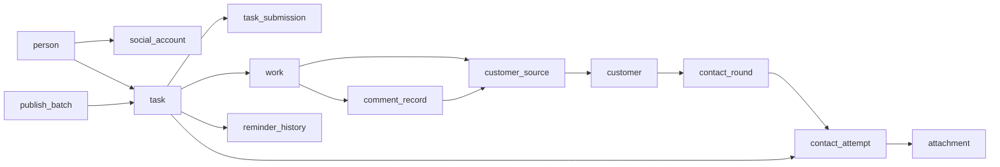

# SocialTask SCRM｜工程实施计划 v1.0

> 来源：《素人代发任务管理系统｜完整 SOP 及技术需求文档》（40 页，完整整合版）。
>
> 文档类型：可执行工程实施规格（初稿）。生成日期：2026-11-24。
>
> 状态：**规划方案，尚未创建仓库、编写业务代码、完成真实接口授权或进行实机验收**。
>
> 约束：不使用飞书；企业微信为内部任务通知和跳转入口；统一自有工作台；抖音相关能力必须采用授权接口或人工操作，不使用未经授权采集/自动化登录。

## 0. 决策摘要

**建设方案：自研领域业务平台，而非直接对现成 SCRM 进行大规模魔改。**

- 一个 **Next.js Web 应用**，提供 `/admin` 管理工作台及 `/m` 移动任务 H5；前端采用 TypeScript、shadcn/ui、TanStack Query 和表单校验。
- 一个 **Java Spring Boot 模块化单体**，按 IAM、人员、内容作品、任务流程、线索、企业微信、消息、附件、统计模块划分；MySQL 做真相源，Redis 作缓存与防重，MinIO/OSS 存放对象文件。
- 企业微信的真实职责是“企业内部人员认证 + 应用通知 + 打开 H5”；表单编辑、附件上传、审批、客户记录在自有 H5 完成。
- **MVP 抖音侧采用人工操作及核验**：发布后提交 URL，人工采集真实评论，获授权的人员自行执行合规沟通并回传证据。平台开放能力验证通过后，在后续版本引入官方适配器。
- **先做统一任务引擎和客户唯一档案，再补业务模块**；所有业务模块共用任务、提交、审核、催办、转派、审计及附件能力。
- **安全与合规前置**：不支持冒充普通消费者的商业引导或虚构体验；医疗/医美涉及内容必须有资质与合规审核；未经许可不自动批量私信。

### 关键范围说明

1. 源文档的“P0/P1/P2”是业务优先级，而不是技术依赖顺序。客户最小实体、权限、日志、附件安全必须在首个研发迭代前置，否则 P1 的双路私信和去重无法正确实施。
2. “一个客户一份档案”以可验证外部身份为依据。相同昵称不能视为同一客户。
3. “实际发布时间”与“作品链接提交时间”是不同时间：无法通过授权接口读取时，实际发布时间由人员录入并标记待核验；服务端可以准确记录的是链接提交时间。
4. “企微 API 发送成功”不等同于执行人已读/已处理；系统只将实际操作视为任务状态依据。
5. “两位人员并行私信”的任务模型可保留，但向客户发消息必须满足平台规则、联系授权和限频；如果一人收到回复，另一人的尚未发送任务即时停止。

## 1. 从原 SOP 抽出的核心业务链路

```
人员档案及平台账号绑定
    ↓
管理员建立内容/发布批次（素材、标题、正文、标签、截止时间）
    ↓
系统生成多条个人发布任务 → 企业微信任务卡片 → H5
    ↓
执行人自行发布 → 回填作品 URL → 管理员审核 → 建立作品档案
    ↓
并行：A 官方助理公开评论核验 | B 真实评论人工记录
    ↓
管理员识别真实询问者 → 客户去重/关联作品和评论
    ↓
创建第一轮联系任务（作者与授权助理各自任务、各自证据）
    ↓
记录联系结果 → 任一方已回复 / 拒绝联系：停止剩余重复联系
    ↓
次日调度：仅双方均已联系、均未回复、未拒绝联系且满足许可时生成一次回访
    ↓
授权客服跟进 → 截图/表单 → 更新客户时间线及报表
```

该模型对应原文档第 3–4、7–20、21–22、23–30、33–40 页。源文档里展示的数据（如 128 条任务）只是示例，不作为实际规模容量的依据。

## 2. 人员、角色与身份边界

| 类型 | 平台权限 | 具体行为 | 身份校验 |
|---|---|---|---|
| 超级管理员 | 租户配置、全部数据及授权管理 | 角色维护、集成设置、全局审核 | 后台账号 + MFA（建议） |
| 管理员 | 人员、任务、作品、客户 | 创建批次、分派、核验、异常处理 | 后台账户/企微企业成员 |
| 任务负责人 | 被授权的批次、团队任务 | 下发/跟踪所辖任务 | 后台账户/企微企业成员 |
| 作者 | 本人发布及第一轮联系任务 | 回填 URL、证据、结果 | 企业成员 OAuth 或受控 H5 登录 |
| 助理 | 分配给自己的官方评论、联系任务 | 确认公开回复、上传私信证据 | 同上 |
| 素人/合作创作者 | 本人发布及真实互动记录 | 下载素材、回填 URL | **不假定是企业微信内部成员**；需独立核实外部身份/通知路径 |
| 客服/授权回访人员 | 分配的客户及回访 | 根据客户意愿处理回访，录入结果 | 企业成员 OAuth 或受控 H5 登录 |

**身份风险门槛**：企业微信自建应用消息主要面向应用可见范围内的企业成员。外部创作者是否入企、通过何种合规渠道接收任务必须做 1 个真实账号的 PoC。不能使用固定公共 URL 或仅凭人员编号访问涉及客户信息的任务。

## 3. 推荐技术架构

### 3.1 工程栈

| 层级 | 建议 | 理由 |
|---|---|---|
| Web 管理台 | Next.js App Router、React、TypeScript、shadcn/ui、TanStack Table/Query | 快速做复杂列表、筛选、审核侧滑、时间线 |
| 移动 H5 | 同一 Next.js 应用 `/m/*`、React Hook Form + Zod | 无需先做小程序；可从企微消息跳转，内外权限分离 |
| API 服务 | Java 21 + Spring Boot 3.x 稳定维护版本 + Spring Security + MyBatis-Plus | 面向人员任务与复杂业务约束，易维护 |
| 数据库 | MySQL 8+、Flyway 版本迁移 | 统一客户档案、事务及历史追踪 |
| 缓存/限流 | Redis | Token/令牌、分布式互斥、短周期防重 |
| 附件 | MinIO（私有部署）或兼容 S3 的商业 OSS | 预签名上传、独立访问授权及归档 |
| 调度 | Spring Scheduler + 数据库 Job/Outbox，后期再选 Quartz | 初期无需引入复杂消息集群 |
| 通知 | WeCom 适配器 + Outbox + 发送日志 | 实现失败重试与幂等 |
| 测试 | JUnit 5、Testcontainers、Playwright | 任务状态、竞态、权限、端到端 |
| 交付 | Docker Compose（开发/试点）+ GitHub Actions | 可复现部署与持续集成 |

不建议一开始引入微服务、BPMN 全流程引擎、复杂通用表单设计器、RabbitMQ 多集群或 AI 自动识别评论。任务类型有限，可以先用明确的状态机 + 策略接口落地。后续客户需要自由配置审批节点时，再引入 Flowable。

### 3.2 目录结构

```text
socialtask-scrm/
├── apps/
│   └── web/                        # Next.js：/admin 与 /m
│       ├── src/app/(admin)/
│       ├── src/app/(mobile)/
│       ├── src/components/
│       └── src/lib/api/
├── services/
│   └── api/                        # Spring Boot 模块化单体
│       └── src/main/java/.../
│           ├── auth/              # 登录与 RBAC
│           ├── people/            # 人员、社交账号、分组
│           ├── content/           # 内容、素材、发布作品
│           ├── task/              # 状态机、分派、审核、回执
│           ├── comment/           # 真实评论、官方回复核验
│           ├── customer/          # 客户档案、身份、来源、联系轮次
│           ├── message/           # 企微、消息 Outbox、回执
│           ├── storage/           # 附件、预签名、访问鉴权
│           ├── scheduler/         # 提醒、超时、次日任务
│           ├── analytics/         # 指标聚合
│           └── audit/             # 审计日志
├── infra/
│   ├── docker-compose.yml
│   ├── nginx/
│   └── mysql/
├── docs/
│   ├── architecture/
│   ├── api/
│   ├── planning/
│   ├── runbooks/
│   └── acceptance/
└── .github/workflows/
```

### 3.3 系统内部的职责分界

- 人员服务只管理人员与账号，不负责发送提醒；任务服务依据人员 ID 进行任务分派。
- 任务服务只维护通用任务状态与提交审核；作品、评论、客户场景分别通过策略服务校验提交表单和完成后的副作用。
- 客户服务作为客户身份、来源、联系许可、拒绝联系与完整历史的唯一真相源。
- 消息适配器不允许直接修改业务状态；消息是否发送成功只更新 `notification_delivery`。
- 所有对外事件采用 **事务内写 Outbox、事务外发送**。失败可重试，但不得二次创建任务。

## 4. 业务模块与页面清单

### 4.1 管理端路由

| 路由 | 页面 | P 级 | 必要操作 |
|---|---|---:|---|
| `/admin` | 首页工作台 | P1 | 今日待办、异常、超时、待审核、业务指标 |
| `/admin/people` | 人员库 | P0 | 新增/编辑、导入、分组、停用、查历史 |
| `/admin/accounts` | 平台账号管理 | P0 | 多账号绑定、主页和 UID、换号历史 |
| `/admin/contents` | 内容素材管理 | P0 | 图文标题、标签、图片、素材审核 |
| `/admin/publish-batches` | 发布批次 | P0 | 创建内容批次、选择人员、截止时间、批量任务 |
| `/admin/tasks` | 统一任务中心 | P0 | 类型/状态/人员筛选、转派、催办、审核 |
| `/admin/works` | 作品管理 | P0 | 去重作品 URL、链接核验、关联人员 |
| `/admin/comments` | 评论管理 | P1 | 官方评论核验、真实评论录入/分类 |
| `/admin/customers` | 客户列表 | P1 | 身份去重、线索状态、归属/停止联系 |
| `/admin/customers/[id]` | 客户详情 | P1 | 来源作品、评论、联系轮次、证据、时间线 |
| `/admin/followups` | 客户回访 | P1 | 次日筛选、分派、结果审核、拒绝联络 |
| `/admin/messages` | 消息中心 | P1 | 发送日志、失败重试、催办记录 |
| `/admin/settings` | 参数与权限 | P0/P2 | 角色、提醒模板、自动化开关、集成凭证 |
| `/admin/reports` | 统计报表 | P2 | 作品、人员、任务、客户跟进及异常报表 |
| `/admin/audit` | 审计中心 | P0 | 谁在何时做了什么、旧值/新值 |

### 4.2 移动 H5 路由

| 路由 | 场景 | 提交要点 |
|---|---|---|
| `/m/login` | 内部企微 OAuth / 合规外部登录 | 人员身份与账号绑定，任务级权限 |
| `/m/tasks` | 我的任务 | 待处理、待核验、退回、已完成 |
| `/m/tasks/[id]` | 统一任务卡片 | 素材、内容、截止时间、操作按钮 |
| `/m/tasks/[id]/publish` | 发布表单 | 作品 URL + 实际发布时间来源标记 |
| `/m/tasks/[id]/comment` | 官方评论确认 | 确认后转待管理员核验；不需截图 |
| `/m/tasks/[id]/contact` | 首轮联系表单 | 附件必传 + 是否回复 + 补充说明 |
| `/m/tasks/[id]/followup` | 次日回访表单 | 明确身份、截图、意向/关注内容/是否继续 |
| `/m/profile/accounts` | 个人账号绑定 | 查看分配账号、申请更换/核验 |

### 4.3 表单实现方案

P0/P1 固定六类表单组件，不在 MVP 做“任意动态表单搭建器”：

1. 人员/账号新增与变更表单。
2. 作品发布批次表单。
3. 作品结果链接回传表单。
4. 官方助理评论确认表单（无截图）。
5. 客户首轮联系表单（截图必填，作者和助理分别填）。
6. 次日客户跟进表单（截图/意向/关注点/后续动作）。

统一做 `FormDefinition` 接口和 `schema_version`，将字段元信息、校验规则及提交 JSON 版本化。P2 可增加自定义字段但不在 MVP 上线拖拽设计器。

## 5. 领域实体与数据模型

建议使用稳定主键 `BIGINT/UUID`，业务编号仅展示与检索（如 `PUB20261124001`），不承担外键职责；所有交易型数据包含 `created_at`、`updated_at` 和版本字段。

### 5.1 核心表（建议 23 张左右）

| 域 | 表名 | 核心字段/约束 |
|---|---|---|
| 身份 | `user_account` | login_source、person_id、status、last_login_at |
| 身份 | `role`、`user_role` | RBAC，权限按任务归属进一步过滤 |
| 人员 | `person` | `person_no` UNIQUE、wecom_userid、type、status |
| 人员 | `social_account` | platform、person_id、uid(可空)、profile_url、identity_type、status |
| 人员 | `person_group`、`group_member` | 分组、有效起止时间、分派容量 |
| 内容 | `content_package` | 图文标题、正文、话题、approved_by、approval_status |
| 内容 | `content_asset` | attachment_id、排序、素材许可信息 |
| 发布 | `publish_batch` | 任务名、素材包、截止时间、批次状态 |
| 任务 | `task` | `task_no` UNIQUE、type、assignee_id、status、due_at、version、source_id |
| 任务 | `task_submission` | task_id、revision、data_json、submitted_at、review_result |
| 任务 | `task_transition` | from_status、to_status、actor、reason、timestamp |
| 作品 | `work` | platform、account_id、url、platform_work_id、publish_task_id、verify_status |
| 评论 | `comment_record` | work_id、commenter_identity_key、original_text、comment_type、record_origin |
| 客户 | `customer` | customer_no、status、current_owner_id、do_not_contact、consent_basis |
| 客户 | `customer_identity` | platform、external_uid/verified_url、verification_state；昵称不作唯一键 |
| 客户 | `customer_source` | customer_id、work_id、comment_id，允许多个来源 |
| 联系 | `contact_round` | customer_id、round_no、round_type、status、eligibility_date |
| 联系 | `contact_attempt` | round_id、task_id、person_id、reply_status、attachment_id、contact_at |
| 通知 | `notification_outbox` | event_key UNIQUE、recipient、channel、payload、state、retry_count |
| 催办 | `reminder_schedule` | task_id、assignee_version、max_count、next_due、state |
| 催办 | `reminder_history` | task_id、sequence、receiver_id、send_state、sent_at；唯一去重键 |
| 附件 | `attachment` | owner、bucket/key、file_type、size、retention_until、access_level |
| 审计 | `audit_log` | actor、entity、operation、before_json、after_json、trace_id |

数据规模增长后可拆出报表日汇总表；试点期先通过索引及物化统计方式解决，不需要大数据中台。

### 5.2 必须实现的唯一性和并发约束

- `person.person_no` 全局唯一；人员停用采用软停用，历史任务保持可查。
- `social_account` 在外部 UID 已核验时做“平台 + UID”唯一约束；UID 为空不能拿昵称去重。
- `work` 对“平台 + 作品稳定 ID”唯一；缺少平台作品 ID 时，对规范化 URL 或可人工核验的 canonical key 去重。
- `customer_identity` 使用“平台 + 可验证外部标识”唯一；发现冲突需人工合并流程，保留旧档案和合并日志。
- `task_submission` 的 `(task_id, revision)` 唯一，重复回传不覆盖旧截图。
- `contact_round` 的 `(customer_id, round_no)` 唯一，防止次日调度重复生成。
- `notification_outbox.event_key` 唯一；催办通过 `(task_id, assignee_version, reminder_no)` 唯一约束防重复发送。
- 执行状态更新采用数据库事务 + 乐观锁/行锁，处理“客户刚回复、回访任务同时生成”“任务刚完成、催办同时触发”竞态。

### 5.3 关键关系



## 6. 状态机与业务规则

### 6.1 通用任务状态

`DRAFT → READY → DISPATCHED → IN_PROGRESS → SUBMITTED → VERIFYING → COMPLETED`

辅助流转：`SUBMITTED / VERIFYING → REWORK → IN_PROGRESS`；任何未结束状态可由有权人员发起 `CANCELLED` 或 `REASSIGNED`。`EXPIRED` 不应单独作为不可逆的终态，建议作为 `is_overdue` / `overdue_at` 标记，以便过期任务仍可补交并保留超时事实。

**不同任务类型的审核政策：**

- 发布：提交 URL 后产生待核验作品；管理员确认后完成。
- 官方助理评论：执行人点击“已公开评论”后进入待核验，**不上传截图**；管理员在作品评论区核验。
- 真实评论采集：人工录入原文和来源，审核后生效。
- 首轮联系：作者/助理任务分别提交截图与是否回复，各自独立审核；一方回复即停止另一方尚未发送的沟通。
- 次日回访：必须由授权客服按真实身份联系；客户拒绝后立即禁止继续联系。

### 6.2 首轮联系并行规则

```text
创建 contact_round(round_no=1)
  ├─ TASK: FIRST_CONTACT_AUTHOR
  └─ TASK: FIRST_CONTACT_ASSISTANT

任一提交“客户已回复”
  → customer.status=RESPONDED
  → contact_round.status=RESPONDED
  → 尚未联系的同轮任务=STOPPED（已联系者保留事实记录）
  → 推送任务停止通知
  → 阻断第 2 轮任务生成

均已经联系、均未回复、客户不在禁止联系名单
  → 等待次日调度核对，符合条件才可创建 round_no=2
```

**联系授权闸门**：创建任务可以先走内部审核，但真正联系应检查客户主动询问/联系许可、平台消息条件、账号身份、联系频率及 `do_not_contact`。无法证明合法合规联系时不得自动派发可执行的外联任务，转为管理员待确认。

### 6.3 次日跟进准入规则

至少同时满足：

```text
round1.author_attempt.status == CONTACTED_NO_REPLY
AND round1.assistant_attempt.status == CONTACTED_NO_REPLY
AND customer.reply_status == NO_REPLY
AND customer.do_not_contact == false
AND customer.contact_permission_valid == true
AND 当前日 >= round1 结束日的下一自然日（Asia/Shanghai）
AND NOT EXISTS round2(customer_id)
```

次日任务由后台调度**只创建一次**；业务规则保留审批开关（自动创建并分派 / 自动创建待人工确认）。不设置无限多轮的自动追访。需要继续联系时重新审核客户意愿与平台规则。

### 6.4 催办策略

| 类型 | 文档中可用示例 | 工程建议默认 | 特殊规则 |
|---|---|---|---|
| 作品发布 | 每 60 分钟；文档另有最多 40 次示例 | 每 60 分钟、最多 10 次 | 达上限通知管理员、可转派 |
| 官方助理评论 | 每 10 分钟、最多 5 次 | 同文档 | 停止自动循环催办，交管理员处理 |
| 首轮联系 | 截止时间配置、最多 3 次 | 截止时间/人工设置 | 已回复/撤销立刻终止 |
| 次日回访 | 截止时间配置、最多 3 次 | 截止时间/人工设置 | 客户拒绝/已被接待立刻终止 |

注：原文档第 8 页列出“最多 40 次”，第 24 页建议默认作品发布 10 次，第 26 页后台界面配置 1–10 次；正式开发统一规则需产品确认。建议首版“1–10 次可配置、默认 10 次”，不执行无上限反复提醒。

实现：数据库 `reminder_schedule` + 定时扫描；抢占后在同一事务内检查任务最新状态、写入提醒序号与 `notification_outbox`；发送器异步投递到企微。转派更新 assignee_version，历史保留，后续提醒重新计算；取消、完成、拒绝联系等事件停止提醒。

## 7. 接口 API 草案

统一前缀 `/api/v1`；后台与执行端共用同一鉴权网关；所有写入接口有业务幂等策略，外联与状态变化要求审计。

| 方法 | 路径 | 说明 |
|---|---|---|
| GET | `/me` | 当前人员、角色、可访问账号 |
| GET/POST | `/people` | 人员查询、新增 |
| POST | `/people/import` | 批量导入，返回逐行校验结果 |
| POST | `/people/{id}/accounts` | 绑定平台账号；保留旧账号历史 |
| POST | `/content-packages` | 创建待审核素材 |
| POST | `/publish-batches` | 创建发布批次、生成每人单独任务 |
| GET | `/tasks` | 按日期、类型、状态、所属人员查询 |
| GET | `/me/tasks` | 执行人员仅查看本人任务 |
| POST | `/tasks/{id}/submissions` | 提交 URL/表单/附件 ID，保留版本 |
| POST | `/tasks/{id}/review` | 审核通过或退回重做 |
| POST | `/tasks/{id}/transfer` | 转派并保留原人员及原因 |
| POST | `/tasks/{id}/cancel` | 取消并停止提醒 |
| POST | `/works/{id}/verify` | 管理员核验作品链接 |
| GET/POST | `/works/{id}/comments` | 评论读取/人工录入 |
| POST | `/customers` | 建立/匹配客户档案（服务端去重） |
| GET | `/customers/{id}/timeline` | 客户完整来源与联系时间线 |
| POST | `/customers/{id}/contact-rounds` | 创建首轮或授权次日跟进 |
| POST | `/customers/{id}/do-not-contact` | 禁止进一步联系 |
| POST | `/attachments/presign` | 获得指定用途的上传凭证 |
| GET | `/attachments/{id}/download-url` | 严格鉴权后短时下载链接 |
| GET | `/notifications` | 消息发送/失败与催办记录 |
| GET | `/dashboard/summary` | 今日发布、任务、异常、有效线索 |
| GET | `/audit-logs` | 管理员审计检索 |

典型提交 JSON 示例：

```json
{
  "taskId": "task-opaque-id",
  "idempotencyKey": "client-generated-unique-key",
  "schemaVersion": 1,
  "payload": {
    "workUrl": "https://www.douyin.com/video/example",
    "publishedAt": null,
    "publishedAtSource": "UNVERIFIED"
  },
  "attachments": []
}
```

首轮私信提交则校验 `attachments.length >= 1` 且至少一个 `PRIVATE_MESSAGE_SCREENSHOT`，后端校验文件真实存在、属于当前提交人且已扫描通过。

## 8. 企业微信与抖音集成实施

### 8.1 企业微信 PoC（第 0 周完成）

1. 使用有权限的企业微信主体创建自建应用，获取 `CorpID`、`AgentID`、应用 Secret；Secret 只存服务端加密配置。
2. 为至少一位真实内部执行人配置应用可见范围和账号映射。
3. 验证企业微信 H5 OAuth 获取当前成员标识，完成系统用户绑定与权限检查。
4. 后台创建一条测试任务，通过文本卡片发送标题、截止时间、H5 跳转 URL。
5. 手机企业微信打开任务，提交 1 张测试图片，测试服务端预签名上传、任务状态与审核。
6. 关闭应用权限/更换成员后验证异常和告警。
7. 单独验证外部素人身份、入企成本和通知可达性，不以内部成员接口成功代表外部人员成功。

**PoC 证据**：应用权限截图（隐藏密钥）、请求/响应日志、企微内消息截图、H5 登录主体、任务状态、文件上传结果、错误场景。

### 8.2 抖音能力分级

| 能力 | 首版方案 | 官方能力验证后 | 不能做的假设 |
|---|---|---|---|
| 发布作品 | 执行人员手动发帖、回填链接 | 授权投稿/分享能力 | 不假设可以替任何素人账号后台发帖 |
| 作品资料 | 人工核验 URL 与时间 | 有授权时获取视频元信息 | URL 提交时间不等于平台发布时间 |
| 公开评论 | 官方助理人工回复、管理员核验 | 有可用已获批 scope 才接入接口 | 不用自动批量评论制造虚假互动 |
| 真实评论 | 管理员人工录入与分类 | 按应用类型申请并验证可用评论能力 | 官方某评论列表接口标注“暂不开放” |
| 私信联系 | 授权人员在平台正常操作，系统记录结果 | 仅符合场景、用户授权及准入才接 API | 不假设可自动向任意评论人发送私信 |
| 客户标识 | UID 可用时保存；否则人工核验主页 | 使用合法获取的外部身份字段 | 昵称不作唯一身份依据 |

官方参考：

- 抖音移动/网站能力概览：https://developer.open-douyin.com/docs/resource/zh-CN/dop/ability/
- 抖音小程序视频评论接口：https://developer.open-douyin.com/docs/resource/zh-CN/mini-app/develop/server/basic-abilities/video-id-convert/video-review-data/comment-list
- 抖音小程序私信能力：https://developer.open-douyin.com/docs/resource/zh-CN/mini-app/develop/tutorial/open-capabilities/management/private-domain/private-and-group-message
- 企业微信应用消息接口（文档镜像，实际以企业微信官方控制台验收）：https://s.apifox.cn/apidoc/docs-site/406014/api-10061348

## 9. 研发排期：8–10 周团队版 / 12–16 周单人参考

以下为**建议计划，不是已完成进度，也不是交付承诺**。假设 2 名有经验的全栈/前后端工程师并有部分 QA 支持，企业微信主体和测试账号已准备就绪。接口授权受外部审核影响，不能直接算作研发可控时间。

| 阶段 | 参考时间 | 目标 | 退出条件 |
|---|---|---|---|
| S0 可行性验证 | 第 0 周，3–5 个工作日 | 企微真实消息/H5 身份/上传 PoC、平台准入与合规审核 | 一条通知到一条任务结果完全通 |
| S1 基础平台 P0 | 第 1–2 周 | 仓库、环境、RBAC、人员、账号、分组、附件、审计 | 能导入 20 人、关联多账号且权限隔离 |
| S2 发布任务 P0 | 第 2–3 周 | 素材包、批量下发、URL 回传、作品建档、审核、催办 | 5 人/1 组全流程可执行，可防重复建档 |
| S3 评论模块 P1 | 第 3–4 周 | 官方助理评论核验、真实评论记录与关联 | 两条并行流程独立、官方评论不要求截图 |
| S4 客户与首次联系 P1 | 第 4–6 周 | 客户去重、来源、双路任务、截图、回复停止逻辑 | 同一客户单档案、多源、多联系记录；回复停另一方 |
| S5 次日回访 P1 | 第 6–7 周 | 次日调度、授权客服、停止联系、转派与提醒闭环 | 条件准确、仅生成一次、拒绝联系后无消息 |
| S6 统计与质量 P2 | 第 7–8 周 | 工作台指标、日志检索、备份、脱敏、性能/安全测试 | 验收测试全绿，权限和日志可追溯 |
| S7 试点与修复 | 第 8–10 周 | 小范围试运行、异常复盘、回归 | 真实用户验收并形成上线决策 |

### 依赖关系

- 登录/RBAC、人员与账号 → 发布任务下发。
- 作品档案 → 评论任务/评论记录。
- 客户身份去重、来源关系、附件安全 → 首轮联系。
- 首轮双方联系结果 → 次日调度。
- 任务状态机、事件记录 → 催办/转派/消息中心/统计。
- 平台能力 PoC → 自动集成方案是否开通；**不影响人工版核心闭环上线**。

## 10. GitHub Issue 级工作分解

每项需要一个 PR，合并前附功能验证证据；**以下都是待开发任务**。

| Issue | 优先级 | 工作项 | 前置依赖 | DoD 核心标准 |
|---|---|---|---|---|
| ST-001 | P0 | Monorepo、开发环境、CI、Flyway | 无 | 一键启动、数据库迁移、流水线成功 |
| ST-002 | P0 | JWT/企微 OAuth/后端鉴权 | ST-001 | 未登录/越权不能访问业务资源 |
| ST-003 | P0 | RBAC + 数据行权限 | ST-002 | 作者看不到别人的任务、截图 |
| ST-004 | P0 | 人员、分组、账号、导入 | ST-001 | 多账号分离，停用历史保留 |
| ST-005 | P0 | 文件服务、隐私附件 | ST-002 | 私信截图仅授权可读，签名 URL 限时 |
| ST-006 | P0 | 通用任务状态机 | ST-003/004 | 状态合法性、退回、历史轨迹 |
| ST-007 | P0 | 任务审核、提交版本与转派 | ST-006 | 重复提交、审核竞态、旧执行人保留 |
| ST-008 | P0 | 企业微信通知适配器 | ST-002/004 | 真人消息跳转 H5，失败日志可查 |
| ST-009 | P0 | Outbox、发送重试与幂等 | ST-008 | 消息重复事件不创建重复业务 |
| ST-010 | P0 | 内容素材及合规审核 | ST-005 | 未审核营销内容不得下发 |
| ST-011 | P0 | 发布批次与多人任务生成 | ST-006/010 | 每人单独 task，批量返回异常明细 |
| ST-012 | P0 | 作品 URL 回传及唯一建档 | ST-011 | URL 重复拦截、无效链接待核验 |
| ST-013 | P0 | 催办、超时、取消、转派计算 | ST-006/009 | 次数封顶、完成即停止、保留历史 |
| ST-014 | P1 | 官方助理评论任务与核验 | ST-012 | 不用截图，确认后待核验 |
| ST-015 | P1 | 真实评论记录、分类、来源 | ST-012 | 评论与作品可追溯、未授权不抓取 |
| ST-016 | P0依赖/P1业务 | 最小客户档案和去重 | ST-003 | 相同 UID 识别、同昵称不误合并 |
| ST-017 | P1 | 客户来源记录与时间线 | ST-015/016 | 一客多作品来源 |
| ST-018 | P1 | 首轮双路联系任务 | ST-016/017/006 | 两条独立任务、独立截图与结果 |
| ST-019 | P1 | 回复任意方自动停止重复联系 | ST-018 | 并发下不能重复派发，停止通知可追踪 |
| ST-020 | P1 | 次日资格检查与单次回访 | ST-018/019/013 | 双未回复才生成、幂等、拒绝联系阻断 |
| ST-021 | P1 | 移动端 6 类表单 | ST-005/006/012/018 | 移动端可操作且错误恢复不丢草稿 |
| ST-022 | P2 | 工作台及报表 | ST-012/018/020 | 与数据库记录一致，筛选可复现 |
| ST-023 | P0 | 审计、隐私和保留策略 | ST-001/003/005 | 关键操作记录新旧值、附件到期策略 |
| ST-024 | P0/P1 | 单元、集成、E2E 和安全验收 | 对应各模块 | 核心用例全覆盖并留存证据 |
| ST-025 | P2 | 授权抖音 API 适配层 | S0 准入通过 | 不通过时自动退回人工工作流 |

### Git 提交建议

采用 `main` + 短生命周期 PR，**不建议所有功能开发完才统一提交**。例如：

```text
chore: bootstrap socialtask monorepo and local compose
feat(auth): implement role and row-level permission enforcement
feat(people): add person account and group registry
feat(tasks): implement task state machine and assignment
feat(publish): add batch publishing tasks and work URL submission
feat(wecom): send text-card notifications with outbox
feat(crm): add deduplicated customers and source timeline
feat(contact): add paired first-contact task workflow
feat(followup): schedule eligible next-day follow-ups
fix(reminders): enforce upper bound and stop-on-completion
```

## 11. 验收清单（至少 22 项）

| ID | 验收场景 | 预期结果 |
|---|---|---|
| AT-01 | 导入包含重复人员编号的名单 | 重复行有错误详情；合法行可导入且不会覆盖历史 |
| AT-02 | 一人绑定多个抖音账号 | 分别保留完整账号档案 |
| AT-03 | 抖音账号更换 | 旧作品及任务仍能查到旧账号 |
| AT-04 | 停用人员 | 不删除历史；未完成任务进入人工处理 |
| AT-05 | 一批次分配 20 人 | 生成 20 条独立个人任务，通知/状态可单独查询 |
| AT-06 | 同 URL 由两个人重复提交 | 作品唯一性校验，不能重复建档 |
| AT-07 | 无法打开作品 URL | 标记待核验而不宣称成功发布 |
| AT-08 | 作者提交作品后评论分支 A/B | 两个分支独立运行，互不阻塞 |
| AT-09 | 助理公开评论 | 执行人无需截图，管理员核验后才完成 |
| AT-10 | 两条真实评论属于同一 UID | 创建一客多来源关系 |
| AT-11 | 两位客户恰好昵称一致、UID 不同 | 不误合并 |
| AT-12 | UID 缺失、主页未核实 | 不自动合并，进入人工核验 |
| AT-13 | 作者与助理各收到首轮任务 | 任务各自有独立审核/截图/执行时间 |
| AT-14 | 首轮私信未上传截图 | 不允许完成提交 |
| AT-15 | 客户回复作者但助理尚未发送 | 助理任务停止、下一轮不生成 |
| AT-16 | 客户回复助理但作者已发送 | 保留两人联系事实，不再重复联系 |
| AT-17 | 双方均“已联系未回复” | 次日符合许可时只创建一条回访任务 |
| AT-18 | 次日调度重复触发 3 次 | 仍仅有一条第二轮任务 |
| AT-19 | 客户明确拒绝联系 | 所有待执行外联任务停止、后续提醒不发送 |
| AT-20 | 自动催办达到上限 | 停止继续提醒并通知管理员 |
| AT-21 | 任务提交/审核与催办同秒发生 | 不出现任务完成后继续推送催办 |
| AT-22 | 管理员转派任务 | 原执行人、理由、时间、旧提醒全部保留 |
| AT-23 | 非授权用户猜测附件 ID | 下载拒绝，日志记录访问行为 |
| AT-24 | 企业微信发送失败或成员失效 | 记录错误、合理重试、管理员可见 |
| AT-25 | 截图上传失败 | H5 保留表单草稿，允许重传 |
| AT-26 | 无抖音开放能力或授权失效 | 人工回填/核验仍可执行完整链路 |
| AT-27 | 客户跨作品再次咨询 | 单一客户档案汇总来源和历史时间线 |
| AT-28 | 内容带未审医美治疗效果宣传 | 拦截发布流程，需资质与内容审核 |
| AT-29 | 客户未授权进行外联 | 禁止自动派发可执行外联任务 |
| AT-30 | 消息发送 API 返回成功、用户未打开 | 仅记发送成功，不误标记为任务已读/已完成 |

**参考非功能性验收目标（需经试点调整，不是现有实测数据）：**

- 试点数据集：100 名执行人员、1000 条任务、2000 条评论记录、500 条客户档案；逐步提升压测规模。
- 典型列表/任务详情接口在试点负载下 P95 不超过 800ms（不含图片上传/外部 API）。
- 任务状态/结果零丢失；通知消息具备重试和幂等；重要动作 100% 留审计事件。
- 绝不允许跨用户读取私信截图；录入敏感信息时展示用途和保留期限。
- 接口不可用时，业务应能在“人工核验”模式下继续推进。

## 12. 安全、平台规范及医疗内容风控

原文档示例出现“医生/机构官方助理账号”“恢复效果”“费用/预约”等医疗美容场景，同时第 19 页存在一段用普通消费者口吻进行二次联系的示例，与第 17–18 页要求“客服/授权人员必须以明确身份联系”相矛盾。

**必须执行以下设计约束：**

1. 官方助理要使用真实且可识别的机构/合作身份，不冒充无关患者或普通消费者；不编造个人治疗经历、好评或效果。
2. 医美相关宣传先核对广告发布主体、广告审查资质、内容及证明材料，运营审核通过才能下发；没有真实依据的疗效描述不能发布。
3. 真实评论是用户实际发布的评论，不能通过任务引导伪造用户评价或操纵平台互动。
4. 客户主动咨询不等于同意不限次数、多账号连续私信。需要可记录的联系基础、限频及拒绝联络开关；营销外联遵守平台规则。
5. 截图可能包含健康、头像、账号、私人会话等敏感数据：上传时可裁切无关信息，后台私有存储、访问鉴权、短时签名 URL、审计下载、到期删除/合法保留。
6. 禁止机器人模拟用户登录、绕过平台限制、批量私信或非法抓取评论/客户标识。

参考监管资料：

- 市场监管总局《医疗美容广告执法指南》：https://www.samr.gov.cn/zw/zfxxgk/fdzdgknr/ggjgs/art/2023/art_d1b46dbc27214abcace53a0ec539f7bb.html
- 《医疗广告认定指南》：https://app.www.gov.cn/govdata/gov/202508/13/534658/article.html
- 抖音开放平台发布能力规范：https://developer.open-douyin.com/docs/resource/zh-CN/dop/operation-standard/platform-capabilities/useclue

## 13. 原 SOP 尚需确认的产品决策（不阻塞人工版基础设施）

| 决策编号 | 原文档存在的歧义/约束 | 建议冻结决策 |
|---|---|---|
| DEC-01 | 执行素人是否在企业微信企业内 | 内部员工走企微 OAuth；外部合作方单独实名 H5，通知通道须通过 PoC |
| DEC-02 | 发布提醒上限 40 vs 10 vs 页面允许 1–10 | 默认 10、最高 10，特殊情况人工处理 |
| DEC-03 | 第 11 页助理评论达到 5 次后“继续重复提醒” vs 25 页上限即停 | 上限即停并通知管理员 |
| DEC-04 | 文档“实际发布时间”自动记录 | 自动记录提交时间；真实发布时间需授权接口或人工核验 |
| DEC-05 | 客户通过昵称/UID 建档 | UID/经核实主页优先，昵称不作自动去重依据 |
| DEC-06 | 首轮作者与助理同时外联 | 两条任务保留；对外联络须先过联系权限/限频闸门，回复后阻断其他任务 |
| DEC-07 | 第 19 页二次回访示例伪装普通顾客 | 废弃，采用第 18 页明确“官方客服”身份的话术 |
| DEC-08 | 抖音评论实时拉取与私信接口 | 不作为 P0/P1 的前提，统一人工模式；官方能力获批后再启用 |
| DEC-09 | 医美广告审查及个人信息保留期 | 项目上线前由业务/法务负责人明确并落到系统参数 |
| DEC-10 | 外部人员能否看到客户完整信息 | 默认仅看到完成任务所需的最少字段，不显示联系方式与其他联系人信息 |

## 14. 试点上线 Runbook

1. **准备**：域名及 HTTPS、企业微信自建应用及其可见范围、测试员工、合法的素材和演示数据、隐私说明与平台条款。
2. **部署**：MySQL、Redis、对象存储、API、Web；导入迁移脚本、创建管理员、配置存储及回调域名。
3. **验证**：至少一名管理员、一名作者、一名助理、一名客服的真实设备完成“发布 → 评论 → 客户 → 双路联系 → 次日回访（未回复情形）”演练；截屏/日志留证。
4. **小范围运行**：先从 5–20 名授权执行人员、1–3 个分组开始；所有异常人工接管，禁止自动外联测试真实客户。
5. **监控**：任务超时数、审核积压、企业微信发送失败率、H5 上传失败率、客户重复建档率、拒绝联系事件、越权访问告警。
6. **回退**：支持禁用企微通知/自动次日调度/催办，保留人工任务处理；版本回滚和数据库备份必须在发布前演练。
7. **验收**：AT-01–AT-30 核心用例记录“通过/失败/未测”，附操作人、时间、数据、截图/日志证据，再决定正式上线。

## 15. 第一批研发行动（按顺序）

- [ ] 将本文与原始 SOP 固定为项目 `docs/planning/` 中的需求基线。
- [ ] 输出 3 份 ADR：ADR-001 自研业务平台；ADR-002 模块化单体技术栈；ADR-003 企微 H5 + 抖音人工优先。
- [ ] 完成 S0 企业微信真实账号 PoC 和抖音权限清单核对，记录接口能力矩阵。
- [ ] 创建 GitHub 仓库、Docker Compose、后端 Flyway、基础 CI。
- [ ] 先落 ST-002/003/004/005/006/023：身份、人员、账号、附件、统一任务和审计。
- [ ] 实现 ST-008/009：真实通知链路及失败重试。
- [ ] 实现 ST-010/011/012/013：发布批次→链接回传→作品建档→提醒。
- [ ] 通过 P0 回归后，再实施评论、客户、双路联系及次日回访。
- [ ] 试点前完成产品决策 DEC-01–DEC-10 和 AT-01–AT-30 验收。

---

**交付判定**：管理员能在自有工作台发起任务、执行人通过允许的渠道进入 H5 并提交可验证结果、系统能正确关联人员—作品—评论—客户—多次联系、持续催办但严格封顶且保留审计，才可判定核心 MVP 闭环已打通。未完成企业微信/抖音实测前，不标注任何平台接口“已打通”。
